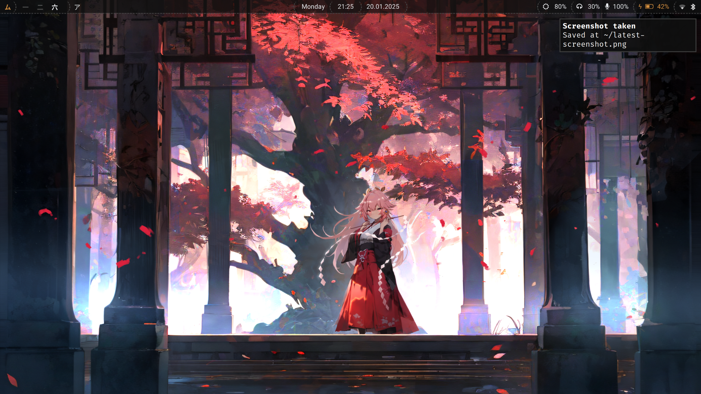
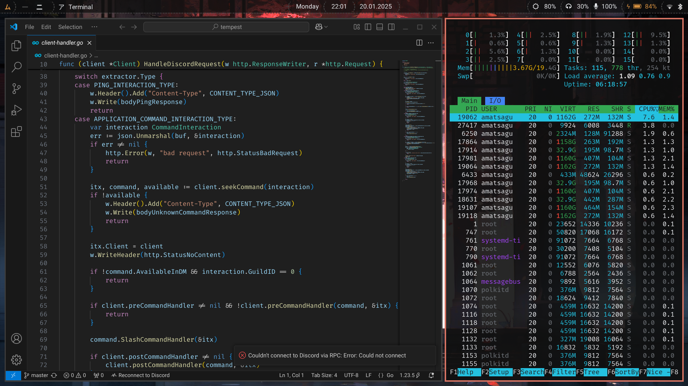
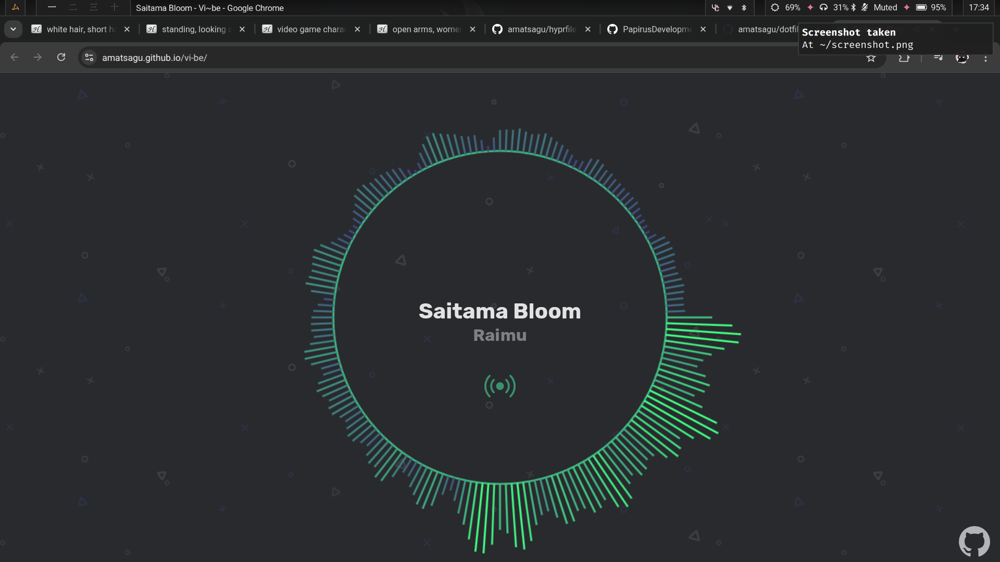

<h2 align=center>Amatsagu Dotfiles ✦ InkTide ✦</h2>

<a href="#gallery">Gallery</a> - <a href="#install">Install</a> - <a href="#usage">Usage</a> - <a href="#credit">Credit</a>
 
┗━ <a href="https://www.reddit.com/r/unixporn/comments/1d9r6a8/sway_like_falling_petals_and_flowing_water/">See OG reddit thread</a> ━┛

<h1></h1>

- Linux distro - **any Arch-based** (tested on CachyOS)
- Tiling manager - **hyprland v0.56.2+**
- GTK theme - **adw-gtk3-dark** (auto themed with Noctalia)
- QT5/QT6 theme - **default** (auto themed with Noctalia)
- Icon theme - **papirus** (auto themed with Noctalia)
- Cursor theme - **default**
- Colors - **dynamic** (auto themed with Noctalia based on wallpaper)
- Fonts - **MD IO Trial, Fira Code, Noto Sans, CJK**
- Terminal - **Foot**
- Video player - **mpv**
- Image viewer - **imv**
- Music player - **spotify-launcher** (with spicetify)
- Text editor - **vscodium, nano**
- File manager - **Thunar** (with GVFS & Archive Manager)
- Shell - **noctalia v5.0.0+** (bar, session control, lockscreen, OSD, bluetooth, wifi, notifications, app menu)
- XDG desktop portals - **wlr, gtk, hyprland**
- Polkit - **hyprpolkitagent**
- Audio - **alsa-lib, alsa-utils, pipewire, pipewire-alsa, pipewire-audio, pipewire-audio, pipewire-pulse, wireplumber**
- Network - **iwd, networkmanager, wpa_supplicant**
- Bluetooth - **bluez, bluez-hid2hci, bluez-obex, bluez-utils**

## Gallery

  

  

  

## Install

> [!NOTE]
> This configuration is made by myself, for myself. I've wrote step by step installation manual for people who would like to try replicating it + probably for my future self once Arch something breaks :D.
>
> I've used to provide automatic installation script but it's too unstable with ever changing Arch.

0. [Minimal CachyOS installation](https://github.com/amatsagu/dotfiles/blob/master/manual/0.%20minimal%20os%20install.md)
1. [Launching Hyprland](https://github.com/amatsagu/dotfiles/blob/master/manual/1.%20launching%20hyprland.md)
2. [Applying dotfiles](https://github.com/amatsagu/dotfiles/blob/master/manual/2.%20applying%20dotfiles.md)
3. Final tweaks

### Bonus instructions
4. Security patches

## Usage

### Keybinds
Most of the keybinds are from i3/Sway, core keybinds:

- **Mod key**: Windows/Super logo [Mod4].
- **Close Window**: `Mod + Shift + Q`
- **Terminal**: `Mod + Enter`
- **Launcher**: `Mod + D`
- **File Manager**: `Mod + B`
- **Session Control**: `Mod + Shift + E`
- **Lock Screen**: `Mod + L`
- **System Preview:** `Mod + S`
- **Noctalia Shell Settings:** `Mod + Shift + S`

You'll find them in your `~/.config/hypr/module/keybind.lua`