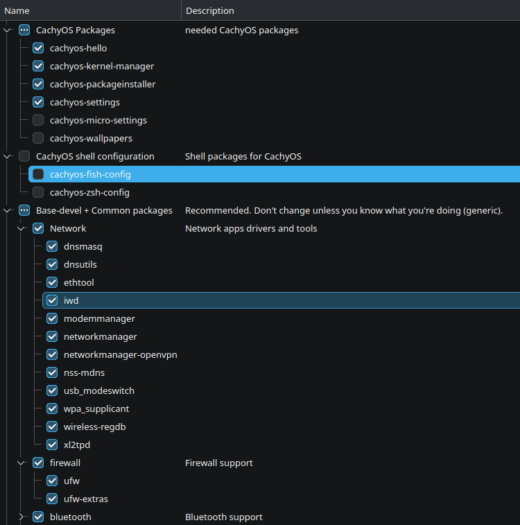
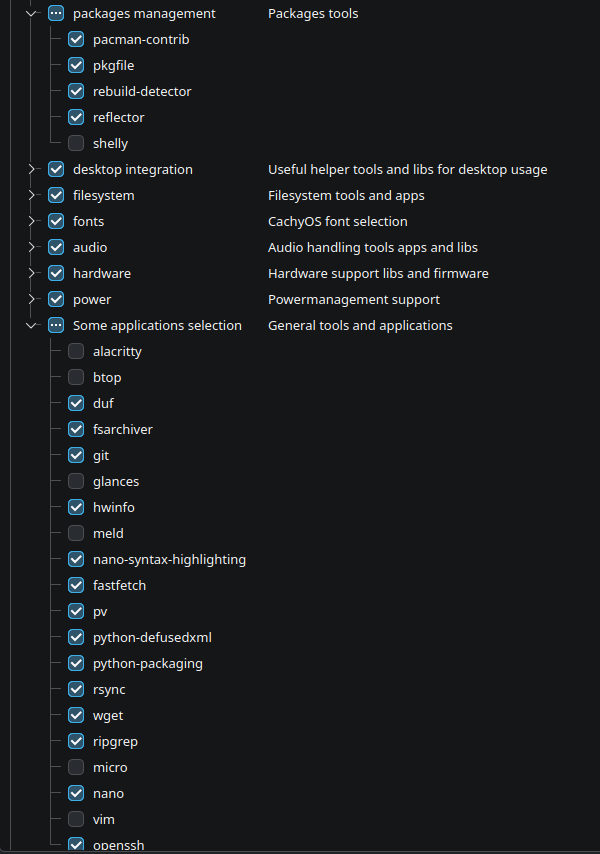
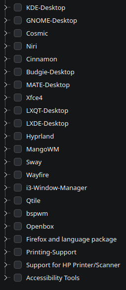

<h2 align=center>Chapter 0</h2>
<h3>Minimal CachyOS installation</h3>

> [!NOTE]
> After this chapter, you'll have bare minimal CachyOS OS with network, bluetooth and audio services working out of the box. There will be no graphical interface to start so don't be scared - that's expected.
>
> This chapter should take max ~10-15 minutes.

 

1. Prepare bootable pendrive with latest ISO of [CachyOS](https://cachyos.org/).
    - Tutorial from Windows: https://medium.com/@sahendra_/create-a-linux-bootable-usb-stick-53e663dbd2b8
    - Tutorial from Linux: https://linuxconfig.org/how-to-make-a-bootable-usb-from-an-iso-in-linux
2. Reboot your machine into bios and disable secure boot. CachyOS by default doesn't support secure boot (there are instructions how to add it in bonus chapter 4). Remember to save changes (commonly on F10)!
3. Reboot your machine, this time selecting your pendrive. You can achieve this in multiple ways but easiest option is to find one time boot list (sadly different motherboard producers uses different shotcuts, look for F12, F10, F2).
4. Initial start may take some time - after launching into live session of KDE, remember to connect to network. Further steps require stable access to internet. Ethernet should be detected automatically, for wifi check bottom right corner - wifi icon.
5. Proceed with installation until you reach few last steps. Select No Desktop as your graphical desktop preference and at package selection, select only these:`

6. After successful installation, take out pendrive and click reboot/restart button.