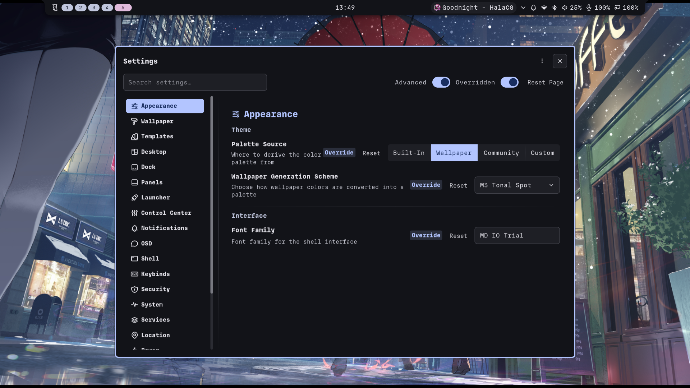
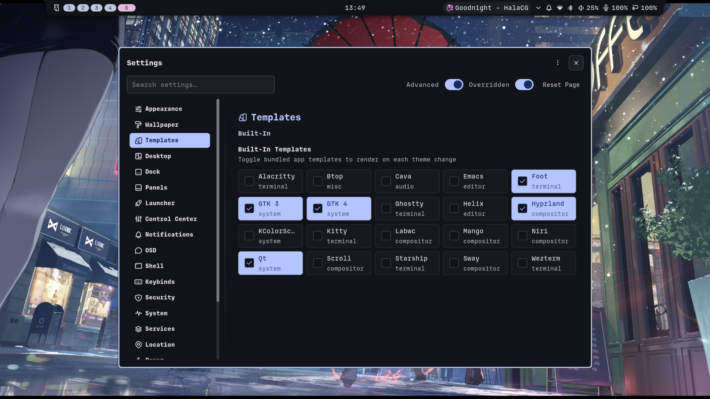
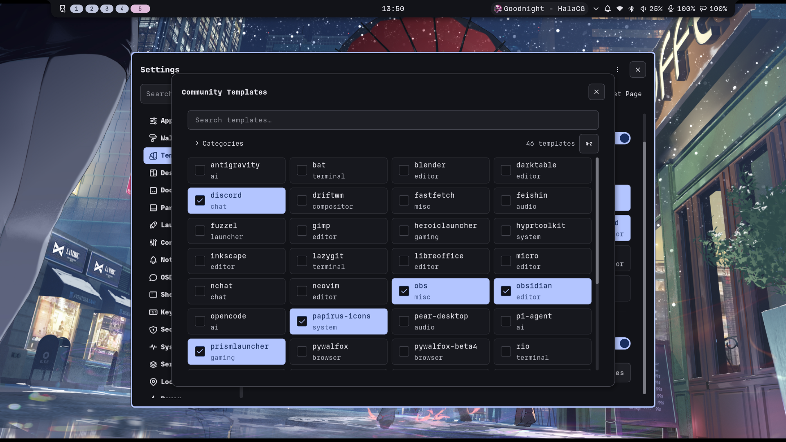
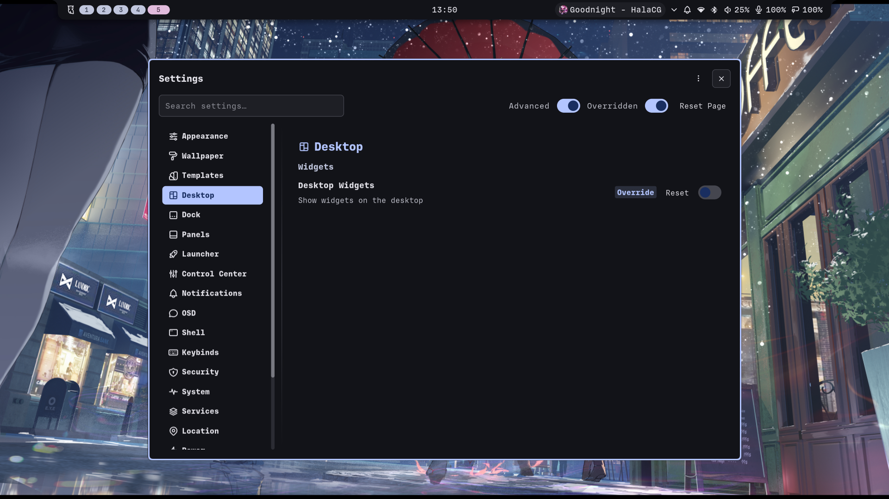
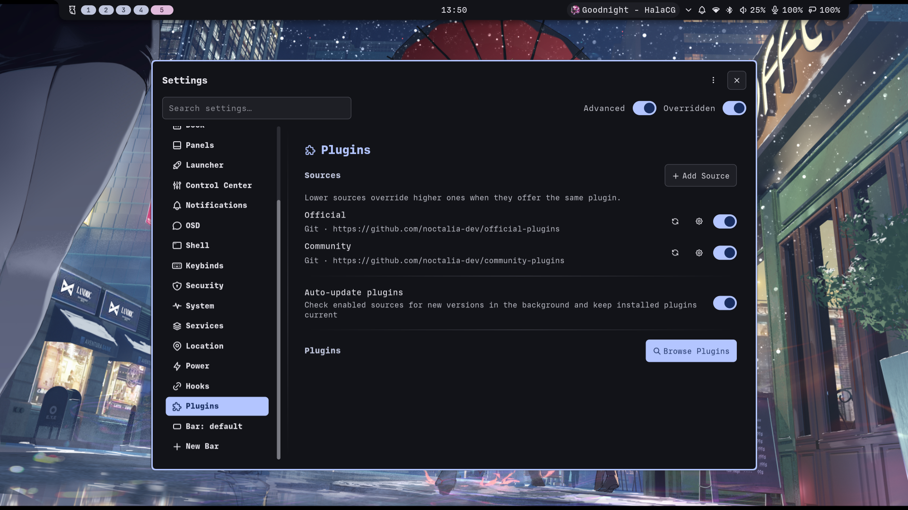
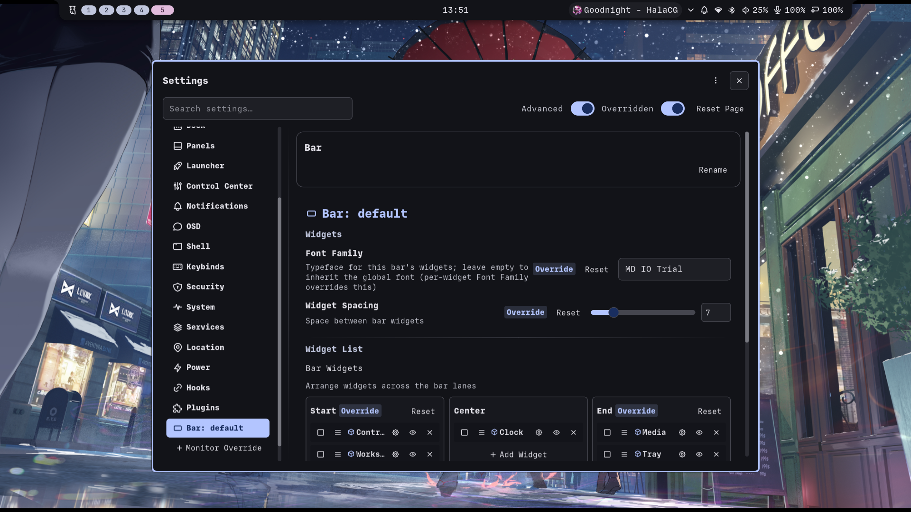
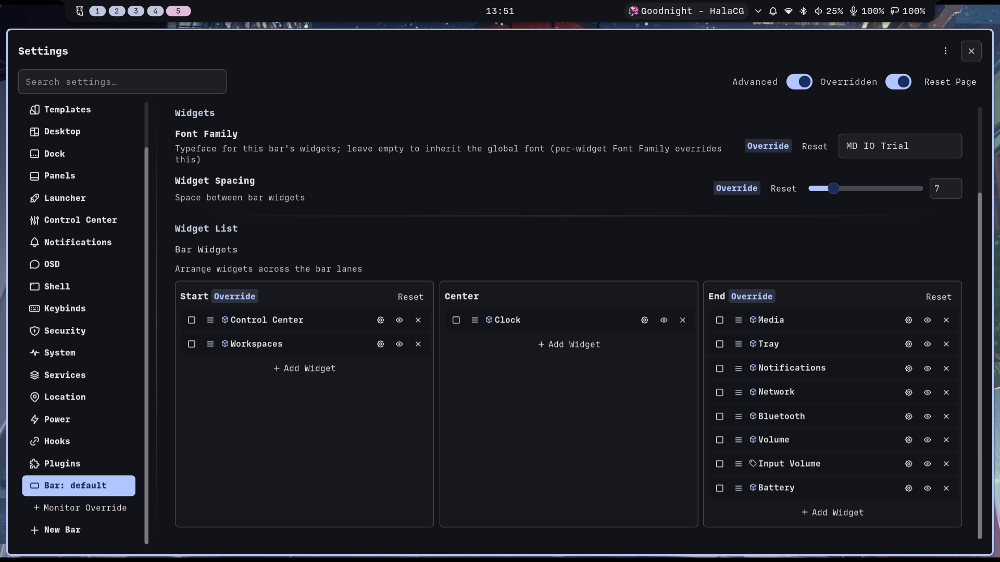
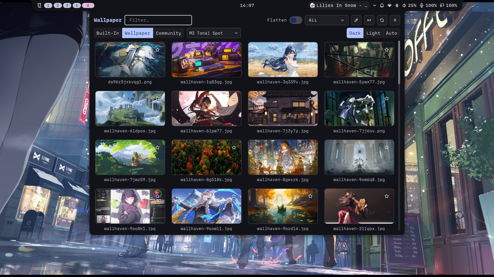

<div align="center">
<h2 align=center>Chapter 2</h2>
<h3>Applying dotfiles</h3>
</div>

> [!NOTE]
> It's time to make things pretty! However, simply copying configs would also clone my personal preferences so we have to do it smartly. Let's start.
>
> This chapter should take max ~20-30 minutes.

1. Clone dotfiles into temporary safe space (eg. Downloads):
```bash
git clone https://github.com/amatsagu/dotfiles.git
cd dotfiles
```

2. Edit preferred keyboard layout in hyprland using `nano`:
```bash
nano configs/hypr/hyprland.lua
```
    - Look near top of the file for `kb_layout`, refer to Hyprland wiki for available options.

3. Verify and edit if needed monitor settings in hyprland using `nano`:
```bash
nano configs/hypr/module/monitor.lua
```
    - Default files assumes you use smaller laptop (13-14'') so they use 125% scale.
    - Everywhere (where possible) we use default scaling so changing those settings should be enough. Optionally you may want to later tweak foot terminal font size, for this: `nano configs/foot/foot.ini`

4. Install theme specific packages:
```sh
sudo pacman -S ttf-fira-code ttf-nerd-fonts-symbols ttf-noto-nerd noto-fonts noto-fonts-cjk noto-fonts-emoji noto-fonts-extra adw-gtk-theme papirus-icon-theme glib2 gsettings-desktop-schemas dconf
```

5. Clone configs, special fonts and wallpapers (for current user):
```bash
mkdir -p ~/.config
cp -rfT ./configs ~/.config
mkdir -p ~/.local/share/fonts
cp -rf ./fonts/* ~/.local/share/fonts/
fc-cache -fv
mkdir -p ~/Pictures/Wallpapers/
cp -rfT ./wallpapers ~/Pictures/Wallpapers/
```

6. Logout & Login back, launch hyprland (`start-hyprland`). You should see that things already look different but it's likely not all Noctalia Shell elements were properly applied yet. So let's double check and set them now (screenshots only show modified options (overrided)):









7. Restart/Force GTK theming:
```bash
gsettings set org.gnome.desktop.interface gtk-theme 'adw-gtk3-dark'
gsettings set org.gnome.desktop.interface color-scheme 'prefer-dark'
gsettings set org.gnome.desktop.interface icon-theme 'Papirus'
gsettings set org.gnome.desktop.interface font-name 'MD IO Trial 10'
gsettings set org.gnome.desktop.interface document-font-name 'MD IO Trial 10'
gsettings set org.gnome.desktop.interface monospace-font-name 'FiraCode Nerd Font 11'
```

8. Restart/Force automatic theming - open Noctalia Shell Settings (`Meta + Shift + S` keybind), open Templates tab and re-enable all built-in + community templates following higher screenshots.

9. Set wallpaper of choice. Open System Preview (`Meta + S` keybind) and click large tile that says your username, it should open wallpaper selector:



> [!NOTE]
> Noctalia & Hyprland may need up to few seconds to update styles after changing wallpaper. Additionally - some GTK apps struggle with refreshing their styles in real time, you may be forced to close all instances of them and open again to see changes.