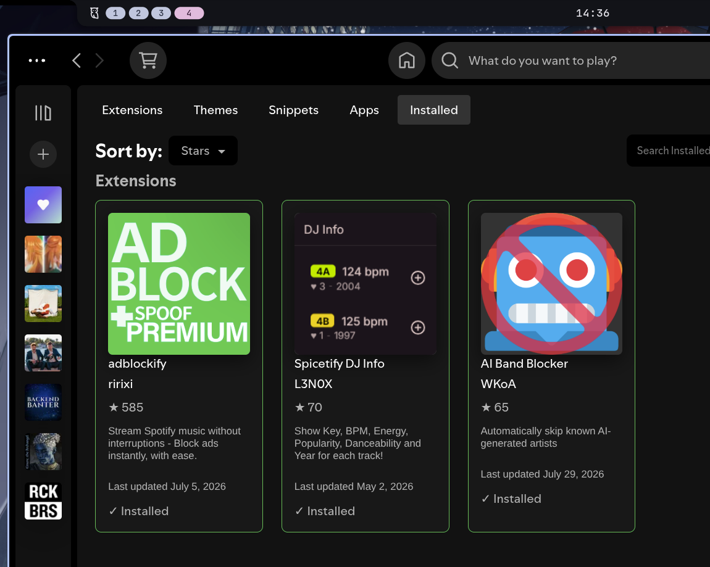

<div align="center">
<h2 align=center>Chapter 3</h2>
<h3>Final tweaks</h3>
</div>

> [!NOTE]
> This chapter is about fine tuning any additional, custom apps you may want to use. It's completely fine to end at chapter 2.
>
> This chapter should take max ~10-15 minutes.

## Spotify
1. Install spotify using safe launcher (wrapper):
```bash
sudo pacman -S spotify-launcher
```
2. Install Spicetify to get rid of annoying ads and AI "music" (include marketplace):
```bash
curl -fsSL https://raw.githubusercontent.com/spicetify/cli/main/install.sh | sh
```
3. Link Spicetify with Spotify Launcher. Make sure to run it from new terminal to refresh path:
```bash
spicetify config spotify_path "$HOME/.local/share/spotify-launcher/install/usr/share/spotify"
```
4. Launch Spotify and let it sit idle for ~60s for it to generate all needed files, then close.
5. Apply Spicetify patches:
```bash
spicetify backup apply
spicetify update
```
6. Restart Spotify (even if it opened automatically).
7. Go to marketplace (new icon in top left corner) and add:



8. Restart/Reload Spotify for extensions to work properly.

## VSCode (VSCodium)
1. Install VSCode or VSCodium (recommended vscodium):
```bash
sudo pacman -S vscodium
```
2. Launch VSCodium (Wayland) from app launcher (`Meta + D` keybinds) and open and replace user preferences with provided json (`Shift + Ctrl + P` keybinds, then pick: Open User Settings (JSON)):
```json
{
    "debug.console.fontFamily": "Fira Code",
    "editor.fontFamily": "Fira Code",
    "editor.fontLigatures": true,
    "workbench.startupEditor": "none",
    "workbench.iconTheme": "vscode-icons",
    "workbench.colorTheme": "Dark Modern",
    "workbench.preferredDarkColorTheme": "Dark Modern",
    "workbench.preferredLightColorTheme": "Dark Modern"
}
```

## Simple Login Manager (Greetd)
1. Install greetd + TUI greetd package:
```bash
sudo pacman -S greetd greetd-tuigreet
```

2. Edit `/etc/greetd/config.toml` file, add/replace this fragment:
```toml
[default_session]
command = "tuigreet --time --remember --cmd start-hyprland"
user = "greeter"

[terminal]
# Ensure it explicitly binds to tty1 (usually already set)
vt = 1
```

3. Enable service (it may log you out):
```bash
sudo systemctl set-default graphical.target
sudo systemctl enable --now greetd.service
```

<br>

<div align="center">

[Previous Chapter](https://github.com/amatsagu/dotfiles/blob/master/manual/2.%20applying%20dotfiles.md) - [Next Chapter](https://github.com/amatsagu/dotfiles/blob/master/manual/4.%20security%20patches.md)

</div>
